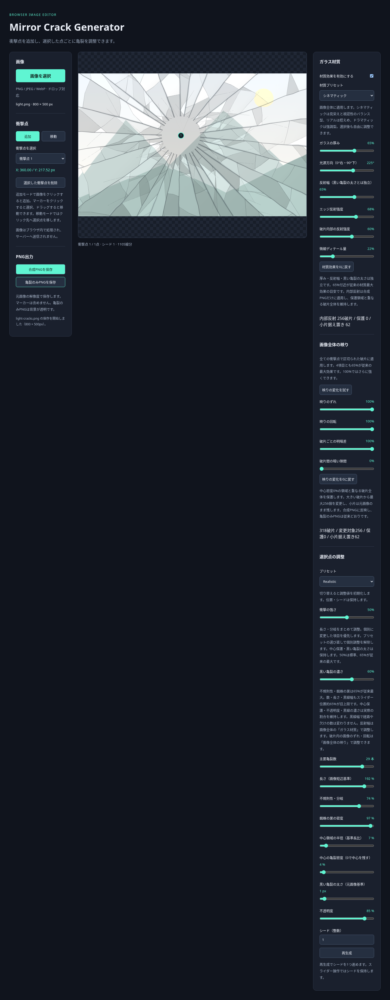

# Mirror Crack Generator

画像の好きな位置から割れ鏡風の亀裂を作り、イラストに重ねるためのブラウザ画像加工ツールです。

**[ブラウザで使う](https://tokimeki-marinosuke.github.io/mirror-crack-generator/)** — インストール・ログイン・APIキーは不要です。



## できること

- PNG / JPEG / WebP の読み込み（ファイル選択・ドラッグ＆ドロップ）
- 複数の衝撃点の追加・選択・移動・削除
- 長さ・角度にゆらぎのある放射状亀裂、不規則な蜘蛛の巣状の接続、短い分岐亀裂
- 中心領域の半径・密度を調整し、顔などを残す空白から細かな破砕まで変更
- Realistic / Animeと3種類の割れ鏡プリセット、衝撃の強さ・黒い亀裂の太さ・濃さの調整
- 同じ画像サイズ・座標・設定・シードから同じ幾何形状を再現
- シネマティック / リアル / ドラマティックのガラス材質、厚み・光源・方向性反射・独立した反射幅・微細ディテール
- 破片ごとの映りのずれ・回転・明暗差・暗い隙間を独立調整
- 元解像度の合成PNG・背景透明の亀裂レイヤーPNGを保存

画像処理とPNG作成はブラウザ内で行い、画像をサーバーへ送信しません。

## 使い方

1. **画像を選択**するか、プレビューへPNG / JPEG / WebPを1枚ドロップします。
2. **追加**モードでクリックし、衝撃点を配置します。複数点を追加できます。
3. マーカーまたは選択欄から編集する点を選び、ドラッグで移動します。
4. 各点の割れ方プリセット、中心保護、黒い亀裂の太さ・濃さを調整します。
5. **ガラス材質**でシネマティック・リアル・ドラマティックを選び、厚み・光源・反射強度・反射幅・内部反射・微細ディテールを調整します。初期値はシネマティックです。
6. **画像全体の映り → 映りの変化を試す**で、破片ごとのずれ・回転・明暗差・隙間を確認します。
7. **再生成**でシードを進めます。**選択した衝撃点を削除**でその点だけを消せます。
8. **すべての調整を初期値に戻す**で、画像と衝撃点の位置・選択を保ちながら全設定を復帰できます。シードも1に戻ります。
9. **合成PNGを保存**または**亀裂のみPNGを保存**でダウンロードします。

| 出力 | 内容 | 保存名 |
| --- | --- | --- |
| 合成PNG | 元画像＋全ての衝撃点の亀裂 | `元ファイル名-composite.png` |
| 亀裂のみPNG | 背景透明の亀裂レイヤー | `元ファイル名-cracks.png` |

画像の映りの変化は合成PNGにだけ適用します。亀裂のみPNGには背景画像・破片の明暗差・新しい隙間を含めません。
どちらも元画像と同じピクセル寸法です。マーカー・点番号・プレビューの余白は出力しません。
合成PNGの非亀裂領域は元画像の透過を保持します。
透過PNGはイラストソフトで別レイヤーとして重ねられます。

### 調整のヒント

- **全設定のリセット**は左パネルの「すべての調整を初期値に戻す」です。材質はシネマティック、映りと全衝撃点は現在の初期設定（つまみ中央50%、隙間0、シード1）に戻ります。「高度な設定」内では材質・映り・選択点ごとにもデフォルトへ戻せます。

- **初期設定を更新しました。** 材質はシネマティック、映りのずれ・回転・明暗差は100%、隙間0。追加する点はRealisticの29本・長さ192%・不規則性74%・蜘蛛の巣97%・中心半径7%・中心密度4%・黒線1px・不透明度85%・シード1です。Realisticの再選択でもこの設定に戻ります。完全な中心保護は密度0%で使えます。

- **つまみの中央50%が初期の見た目**です。横の表示は実際の設定値で、中央が29本・長さ192%・映り100%などに対応します。右側でさらに強くできます。光源・シード・隙間0は従来どおり。[位置と実効値の対応](docs/CENTERED_CONTROLS.md)を参照してください。

- **新シネマティック**は、旧版の材質最大・破断面幅0を基準に、暗い亀裂と局所的な反射を強調しています。顔・文字の自作素材による[新旧比較](docs/crisp-mirror-comparison.png)を参照してください。
- **黒い亀裂の太さ**は各衝撃点で独立、**反射幅**は画像全体で共通です。黒線を太くすると反射位置が輪郭へ追従し、反射自体の幅は変わりません。経路・分岐・シード・欠けの数も変わりません。
- 主要亀裂は太く、接続・分岐は細く描きます。通常描画では旧破断面の太い黒帯・大きな三角形を描きません。「破断面の幅」「欠けの密度」「従来の縁反射」は通常UIから外しました。旧生成APIは互換・比較用に残しています。
- 材質の実効値65付近が従来最大効果の目安です。今回の初期値を中央50に置き、右側では断面や反射区間をさらに広げます。単なる一様な黒塗り・白い発光にはしません。光源は0°が右、90°が下、225°が左上です。
- 材質プリセットは画像全体で共通です。リアルは控えめ、ドラマティックは強調型です。適用後もスライダーを変更できます。点ごとのRealistic / Anime、割れ方プリセットや衝撃マクロからは独立しています。
- **材質効果を有効にする**のチェック解除で、新しい黒線のみの表示になります。旧黒帯・三角形へは戻りません。通常画面で旧描画を再現する切り替えは設けていません。
- **内部反射**は合成PNGにだけ適用します。中心密度0の保護領域と重なる破片全体を維持し、円形の画像ずれを作りません。断面・エッジ反射・微細な光は亀裂のみPNGにも含まれます。
- **画像全体の映り**は、全衝撃点から抽出した大きい破片を優先して最大256個に適用し、小片は据え置きます。初期値はずれ・回転・明暗差100、隙間0です。材質プリセットでは変えず、無効にする場合は各スライダーを0にします。「映りをデフォルトに戻す」は初期値を復元します。閉じた境界がない場合や安全上限を超える場合は元画像を維持します。
- **中心領域の半径**は画像短辺×長さを基準にした割合です。密度0ではその点の中心を保護します。別の衝撃点の亀裂は独立しているため、保護領域を横切る場合があります。
- シード固定中のスライダー操作では乱数を更新しません。同じ画像寸法・座標・設定・シードで再現できます。描画の更新により旧版と色・太さは変わりますが、今回の変更で亀裂生成や破片分割は変えていません。
- 画像を変更すると衝撃点をリセットし、材質はシネマティックに戻ります。元画像のファイルは変更せず、処理・PNG保存はブラウザ内で完結します。

## 動作環境・制限

PCの現行ブラウザを想定し、Chromiumで動作確認しています。
画像の上限は **64MiB / 一辺8,192px / 総画素数16,777,216** です。
ブラウザや端末のメモリによっては上限以内でも失敗します。画像を小さくして再試行してください。

編集状態の保存、Undo/Redo、物理シミュレーションには対応していません。
再読み込みやページを閉じる前に必要なPNGを保存してください。
Safari・Firefox、スマートフォン、上限付近の画像、イラストソフトへの取り込みは追加の実機確認が必要です。

## ローカル開発

Node.js 24 と npm を推奨します（Viteの要件: Node.js 20.19+ / 22.12+）。

```sh
git clone https://github.com/tokimeki-marinosuke/mirror-crack-generator.git
cd mirror-crack-generator
npm ci
npm run dev
```

開発サーバーが表示するURLの `/mirror-crack-generator/` を開いてください。
`index.html` をファイルとして直接開く方法では動作しません。

```sh
npm test       # 単体テスト
npm run build # TypeScriptチェックと dist/ への本番ビルド
npm run preview # ビルド済みアプリをローカル配信
```

ブラウザでのPNG読み戻しテストや内部設計については [開発・検証ガイド](docs/DEVELOPMENT.md) を参照してください。

## 公開・デプロイ

GitHub Pages の公開元を **GitHub Actions** に設定すると、`main` へのpushで
テスト → ビルド → `dist` の公開が自動実行されます。ソースファイルをそのまま配信しないでください。

[Actionsの実行一覧](https://github.com/tokimeki-marinosuke/mirror-crack-generator/actions)で
対象コミットの **build / deploy** が成功したことを確認し、公開URLから画像読み込み・衝撃点追加・PNG保存を試してください。
公開元の設定、手動再実行、白紙・待機・失敗時の確認方法は [公開手順](docs/DEPLOYMENT.md) にまとめています。

正式公開に向けた確認事項・バージョンとタグ・公開後の更新運用は [正式リリース準備](docs/RELEASE_PLAN.md) を参照してください。

## ライセンス

[MIT License](LICENSE)。著作権表示とライセンス文を残す条件で、商用利用・改変・再配布が可能です。
依存ライブラリにはそれぞれのライセンスが適用されます。

要件は [REQUIREMENTS.md](REQUIREMENTS.md)、設計は [ARCHITECTURE.md](ARCHITECTURE.md)、開発計画は [DEVELOPMENT_PLAN.md](DEVELOPMENT_PLAN.md) を参照してください。

材質・映り・選択点のプリセットは常に表示します。各プリセットの下にある「高度な設定」は初期状態で閉じており、個別に開いて細かく調整できます。各グループの「デフォルトに戻す」は効果を0にせず、起動時の設定へ復帰します。「選択点の亀裂をデフォルトに戻す」は選択点だけを初期化し、位置を保持してシードを1へ戻します。全点を戻す場合は左の全体リセットを使います。

カスタムプリセットは各欄で名前（40文字以内）を入力し「保存」すると、「保存済みプリセット」から呼び出せます。同名は同じ種類内で上書き、各種類20件まで。保存済みを選んで「削除」できます。保存先は現在のブラウザのlocalStorageです。再読み込み後も使えますが、別端末への同期はなく、サイトデータ削除で消えます。画像・衝撃点の位置・シードは保存せず、選択点のプリセットは選択中の点だけに適用します。全体リセットで保存済みプリセットは削除しません。
