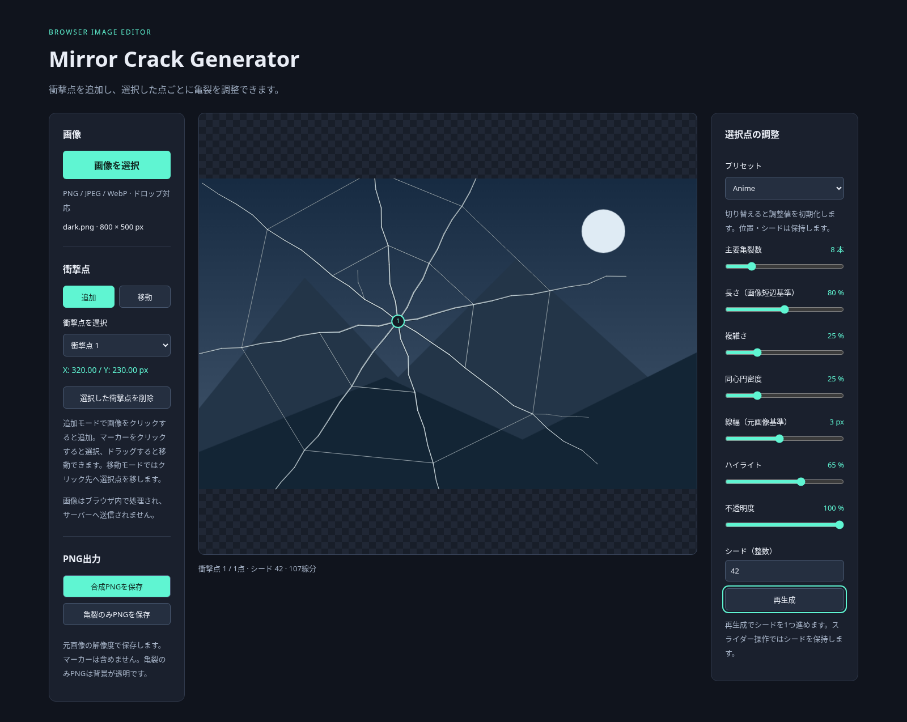

# Mirror Crack Generator

画像の好きな位置から割れ鏡風の亀裂を作り、イラストに重ねるためのブラウザ画像加工ツールです。

**[ブラウザで使う](https://tokimeki-marinosuke.github.io/mirror-crack-generator/)** — インストール・ログイン・APIキーは不要です。



## できること

- PNG / JPEG / WebP の読み込み（ファイル選択・ドラッグ＆ドロップ）
- 複数の衝撃点の追加・選択・移動・削除
- 放射状・同心円状・分岐状の亀裂生成
- Realistic / Anime プリセットと、線の長さ・複雑さ・太さ・透明度・ハイライトの調整
- 同じ画像サイズ・座標・設定・シードから同じ幾何形状を再現
- 元解像度の合成PNG・背景透明の亀裂レイヤーPNGを保存

画像処理とPNG作成はブラウザ内で行い、画像をサーバーへ送信しません。

## 使い方

1. **画像を選択**するか、プレビューへ画像を1枚ドロップします。
2. **追加**モードで画像上をクリックし、衝撃点を配置します。繰り返すと複数点を追加できます。
3. マーカーまたは **衝撃点を選択** から編集する点を選びます。選択点は緑、他の点は黄色です。
4. マーカーをドラッグして移動します。**移動**モードでは画像のクリック先へ選択点を移せます。
5. **Realistic / Anime** と各スライダーで見た目を調整します。設定は各点で独立しています。
6. 形状を変えたいときは **再生成** を押します。**選択した衝撃点を削除** でその点だけを消せます。
7. **合成PNGを保存** または **亀裂のみPNGを保存** でダウンロードします。

| 出力 | 内容 | 保存名 |
| --- | --- | --- |
| 合成PNG | 元画像＋全ての衝撃点の亀裂 | `元ファイル名-composite.png` |
| 亀裂のみPNG | 背景透明の亀裂レイヤー | `元ファイル名-cracks.png` |

どちらも元画像と同じピクセル寸法です。マーカー・点番号・プレビューの余白は出力しません。
合成PNGの非亀裂領域は元画像の透過を保持します。
透過PNGはイラストソフトで別レイヤーとして重ねられます。

### 調整のヒント

- **Realistic** は細い線・多めの分岐・控えめなハイライト、**Anime** は太い主要線・少なめの亀裂を初期値とします。[同じ幾何形状での描画比較](docs/phase4-comparison.png)も参照できます。
- **シード**は形状を再現する整数です。スライダーでは変わらず、**再生成**で1つ進みます。元の設定・位置・シードに戻すと同じ形状になります。
- プリセットを切り替えると選択点の調整値は初期値に戻ります。位置・シード・他の点は保持します。
- 長さは画像短辺に対する割合、線幅は元画像px基準です。線種と衝撃点からの距離に応じて細くなります。
- 不透明度0の点はPNGに出力されません。衝撃点がない場合、合成PNGは元画像、亀裂のみPNGは完全透明です。
- 別画像を読み込むと衝撃点をリセットします。読み込み失敗時は編集中の画像を保持します。

## 動作環境・制限

PCの現行ブラウザを想定し、Chromiumで動作確認しています。
画像の上限は **64MiB / 一辺8,192px / 総画素数16,777,216** です。
ブラウザや端末のメモリによっては上限以内でも失敗します。画像を小さくして再試行してください。

編集状態の保存、Undo/Redo、物理シミュレーションには対応していません。
再読み込みやページを閉じる前に必要なPNGを保存してください。
Safari・Firefox、スマートフォン、上限付近の画像、イラストソフトへの取り込みは追加の実機確認が必要です。

## ローカル開発

Node.js 24 と npm を推奨します（Viteの要件: Node.js 20.19+ / 22.12+）。

```sh
git clone https://github.com/tokimeki-marinosuke/mirror-crack-generator.git
cd mirror-crack-generator
npm ci
npm run dev
```

開発サーバーが表示するURLの `/mirror-crack-generator/` を開いてください。
`index.html` をファイルとして直接開く方法では動作しません。

```sh
npm test       # 単体テスト
npm run build # TypeScriptチェックと dist/ への本番ビルド
npm run preview # ビルド済みアプリをローカル配信
```

ブラウザでのPNG読み戻しテストや内部設計については [開発・検証ガイド](docs/DEVELOPMENT.md) を参照してください。

## 公開・デプロイ

GitHub Pages の公開元を **GitHub Actions** に設定すると、`main` へのpushで
テスト → ビルド → `dist` の公開が自動実行されます。ソースファイルをそのまま配信しないでください。

[Actionsの実行一覧](https://github.com/tokimeki-marinosuke/mirror-crack-generator/actions)で
対象コミットの **build / deploy** が成功したことを確認し、公開URLから画像読み込み・衝撃点追加・PNG保存を試してください。
公開元の設定、手動再実行、白紙・待機・失敗時の確認方法は [公開手順](docs/DEPLOYMENT.md) にまとめています。

## ライセンス

[MIT License](LICENSE)。著作権表示とライセンス文を残す条件で、商用利用・改変・再配布が可能です。
依存ライブラリにはそれぞれのライセンスが適用されます。

要件は [REQUIREMENTS.md](REQUIREMENTS.md)、設計は [ARCHITECTURE.md](ARCHITECTURE.md)、開発計画は [DEVELOPMENT_PLAN.md](DEVELOPMENT_PLAN.md) を参照してください。
